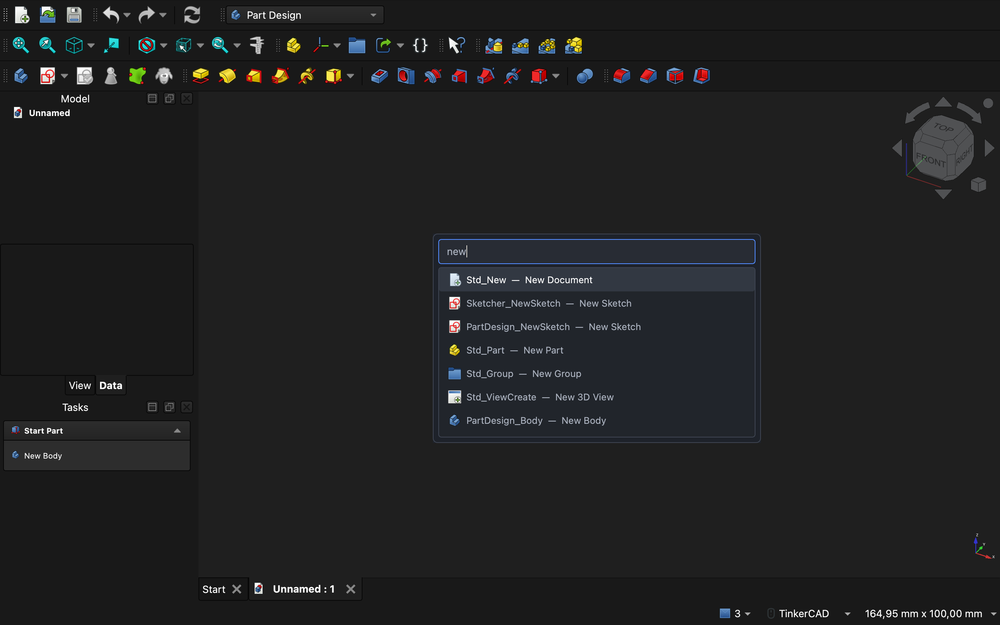
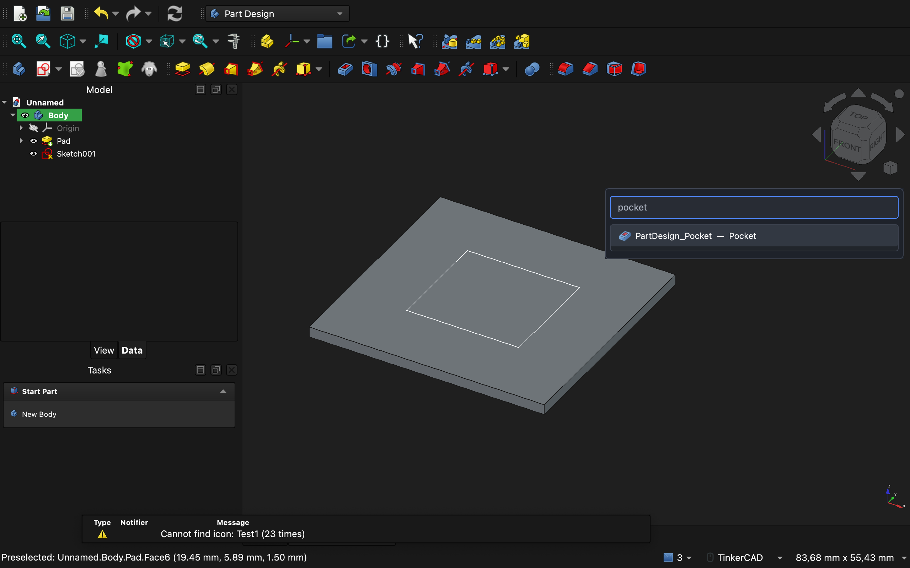
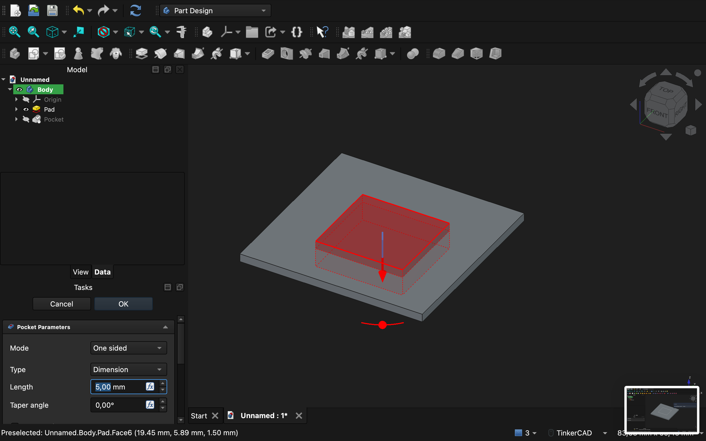

# FreeCad-DynamicCommand

AutoCAD-style Dynamic Command Input for FreeCAD.  
Double-tap `Space` (configurable) anywhere in FreeCAD to open a floating command search bar near your cursor.

## Features
- **Quick Activation**: Double-tap `Space` (default) to open the command bar at the cursor position.
- **Live Command Search**: Fuzzy/token search across all registered FreeCAD commands (`partdesign_body`, `sheetmetal_unfold`, etc.) and menu titles.
- **Keyboard Navigation**:
  - `Up` / `Down` — navigate results
  - `Tab` — autocomplete command name
  - `Enter` — execute selected command
  - `Esc` — close popup
- **Smart Input Protection**: Ignored when typing inside text fields, spinboxes, or editable combo boxes.
- **Settings (`DC-Settings`)**: Type `DC-Settings` in the command bar to configure:
  - Trigger key (any key)
  - Tap count (1–5)
  - Show/hide command icons
- **Auto-start**: Automatically initializes when FreeCAD starts.

## Screenshots

## Installation
### Via FreeCAD Addon Manager (Recommended)
1. Open **Tools → Addon Manager** in FreeCAD.
2. Search for **FreeCad-DynamicCommand** and click **Install**.
3. Restart FreeCAD.

### Manual Installation
Copy this folder into your FreeCAD `Mod` directory:
- **macOS**: `~/Library/Application Support/FreeCAD/v1-1/Mod/FreeCad-DynamicCommand/`
- **Linux**: `~/.local/share/FreeCAD/Mod/FreeCad-DynamicCommand/`
- **Windows**: `%APPDATA%\FreeCAD\Mod\FreeCad-DynamicCommand\`

Restart FreeCAD.

